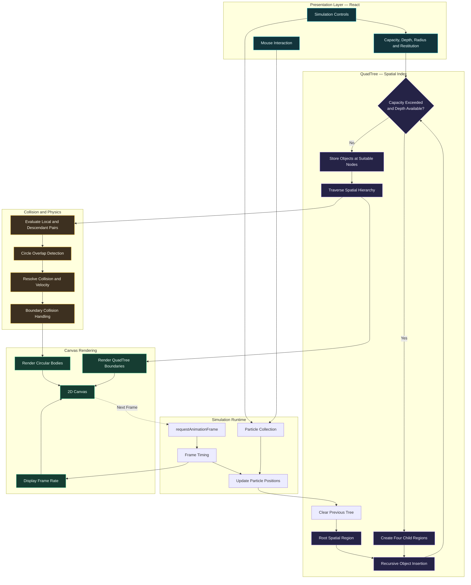

<div align="center">

  <h1>QuadTree Visualization</h1>

  <p>
    <strong>Making spatial complexity visible.</strong>
  </p>

  <p>
    An interactive exploration of recursive spatial partitioning,
    computational geometry, and collision detection through
    dynamic particle simulations and real-time graphics.
  </p>

  [](https://www.typescriptlang.org/)
  [](https://nextjs.org/)
  [](https://react.dev/)
  [](#visualization)
  [](#spatial-partitioning)

  <p>
    <a href="#overview">Overview</a> ·
    <a href="#spatial-partitioning">QuadTree</a> ·
    <a href="#collision-detection">Collision Detection</a> ·
    <a href="#architecture">Architecture</a> ·
    <a href="#visualization">Visualization</a> ·
    <a href="#getting-started">Getting Started</a>
  </p>

  
  &nbsp;
  

  <br />

  <sub>
    Recursive subdivision · Adaptive spatial indexing · Collision detection
  </sub>

</div>

## Overview

QuadTree Visualization is an interactive computational geometry
project exploring how hierarchical spatial data structures can
organize, represent, and process dynamic two-dimensional environments.

A quadtree recursively divides a spatial region into four smaller
quadrants, adapting its structure to the distribution of objects
within the environment.

The application combines this data structure with a particle-based
physics simulation, allowing users to observe how spatial indexing
changes as objects move, interact, and collide.

Rather than treating the quadtree as an abstract hierarchical
structure, the project exposes its behavior through real-time
graphics and configurable simulation parameters.

<div align="center">

  

  <sub>
    Dynamic particle simulation with adaptive spatial partitioning
    and configurable simulation parameters.
  </sub>

</div>

## Features

| Feature | Description |
| :--- | :--- |
| **Recursive Spatial Partitioning** | Adaptive subdivision of two-dimensional regions into smaller quadrants. |
| **Dynamic QuadTree** | Spatial hierarchy rebuilt as particle positions evolve. |
| **Collision Detection** | Spatially organized collision candidate evaluation. |
| **Particle Simulation** | Interactive circular bodies with position, velocity, mass, and radius. |
| **Collision Response** | Momentum-based velocity calculations and configurable restitution. |
| **Configurable Node Capacity** | Control how many objects trigger spatial subdivision. |
| **Maximum Tree Depth** | Limit the depth of recursive partitioning. |
| **Interactive Particle Generation** | Spawn randomized particles or launch individual bodies using mouse gestures. |
| **Real-Time Visualization** | Render particle movement and quadrant boundaries using Canvas. |
| **FPS Monitoring** | Display the current simulation frame rate. |
| **Visualization Controls** | Toggle spatial subdivisions and performance indicators. |

## Spatial Partitioning

A quadtree is a hierarchical spatial data structure in which
each subdivided node contains exactly four child regions.

It is particularly useful for representing two-dimensional
environments containing non-uniformly distributed objects.

Unlike uniform spatial grids, quadtrees can adapt their
resolution according to the spatial distribution of data.

<div align="center">

  

  <br />

  <sub>Reference animation illustrating recursive spatial subdivision.</sub>

</div>

### Recursive subdivision

Each node represents a rectangular spatial region:

$$
R = (x, y, w, h)
$$

Where:

- $(x,y)$ represents the origin of the region.
- $w$ represents its width.
- $h$ represents its height.

When subdivision occurs, the region is partitioned into four
quadrants with half the original width and height.

```text
           Spatial Hierarchy             Spatial Representation

                 Root                   ┌───────────┬───────────┐
                   │                    │           │           │
       ┌──────┬────┴────┬──────┐         │    NW     │    NE     │
       │      │         │      │         │           │           │
      NW     NE        SW     SE         ├─────┬─────┼───────────┤
                       │                │ NW  │ NE  │           │
                 ┌──┬──┴──┬──┐          ├─────┼─────┤    SE     │
                 │  │     │  │          │ SW  │ SE  │           │
                NW NE    SW SE          └─────┴─────┴───────────┘
```

Subdivision occurs when the number of objects stored in a node
exceeds its configured capacity and the maximum tree depth
has not been reached.

This produces an adaptive hierarchy in which densely populated
regions can contain deeper subdivisions.

### Implementation characteristics

| Component | Implementation |
| :--- | :--- |
| Spatial Dimension | Two-dimensional |
| Branching Factor | Four child nodes |
| Default Node Capacity | 4 objects |
| Default Maximum Depth | 5 |
| Subdivision Strategy | Capacity-based recursive partitioning |
| Object Representation | Circular bodies |
| Spatial Boundary | Rectangular regions |
| Tree Update Strategy | Clear and rebuild using current particle positions |
| Traversal | Recursive node processing |
| Rendering | HTML5 Canvas |

Objects are inserted into the deepest spatial region that
fully contains their geometry.

When an object crosses the boundaries of multiple child
regions, it remains stored at an appropriate parent node.

### Core operations

| Operation | Responsibility |
| :--- | :--- |
| `insert()` | Insert an object into a suitable spatial node. |
| `subdivide()` | Partition a node into four child regions. |
| `process()` | Recursively traverse and process the spatial hierarchy. |
| `clear()` | Remove stored references and reset child nodes. |
| `insideRect()` | Determine whether an object is fully contained within a region. |

## Collision Detection

Collision detection is one of the principal applications of
spatial partitioning in computational geometry, game engines,
and interactive simulations.

A naive collision detection algorithm evaluates every possible
pair of objects within an environment.

For $N$ objects, the number of unique pairs is:

$$
C(N) = \frac{N(N-1)}{2}
$$

This results in quadratic time complexity:

$$
O(N^2)
$$

A quadtree organizes objects into spatial regions, allowing
collision evaluation to focus on more relevant groups of
objects rather than uniformly comparing every possible pair.

### Spatial filtering

<table>
  <tr>
    <td align="center" width="50%">
      
      <br />
      <sub><strong>Clustered Distribution</strong></sub>
    </td>
    <td align="center" width="50%">
      
      <br />
      <sub><strong>Mixed Spatial Distribution</strong></sub>
    </td>
  </tr>
</table>

The current implementation evaluates objects stored within
the same node, along with potential interactions between
objects stored in parent and descendant regions.

### Geometric collision test

Two circular bodies overlap when the squared distance between
their centers is smaller than the squared sum of their radii:

$$
(x_2-x_1)^2+(y_2-y_1)^2 < (r_1+r_2)^2
$$

This geometric test avoids calculating a square root during
the initial overlap evaluation.

Once an overlap is detected, the physics engine calculates
the resulting velocities and attempts to resolve the
intersection between both bodies.

### Computational complexity

| Number of Objects | Brute-Force Pair Checks |
| ---: | ---: |
| 100 | 4,950 |
| 500 | 124,750 |
| 1,000 | 499,500 |
| 5,000 | 12,497,500 |
| 10,000 | 49,995,000 |

Under favorable spatial distributions, hierarchical indexing
can substantially reduce the number of collision candidates.

However, quadtree performance depends on object distribution,
node capacity, maximum depth, object dimensions, and traversal
strategy.

Although balanced spatial indexing can approach $O(N \log N)$
behavior under suitable assumptions, quadratic worst-case
behavior remains possible.

The figures above represent theoretical brute-force comparisons,
not measured simulation benchmarks.

## Architecture

The application separates spatial indexing, collision
computation, particle representation, graphical rendering,
and user interaction into dedicated TypeScript components.

The following diagram describes the simulation lifecycle,
from particle generation and configuration to spatial
partitioning, collision evaluation, and Canvas rendering.



### Core components

| Component | Responsibility |
| :--- | :--- |
| `QuadTree` | Root-level spatial index and tree reconstruction. |
| `QuadNode` | Recursive subdivision, spatial containment, and object storage. |
| `QuadObject` | Interface defining spatial containment behavior. |
| `CircleBody` | Particle geometry, physical state, movement, and collisions. |
| `PhysicsEnvironment` | Configurable physical simulation parameters. |
| `Vector2D` | Two-dimensional vector mathematics. |
| `SimulationCanvas` | Simulation lifecycle, spatial processing, and Canvas rendering. |
| `ControlBar` | Interactive configuration and simulation controls. |

The spatial data structure remains independent of the
graphical presentation layer, allowing its core operations
to be reused in other spatial computing applications.

## Physics Simulation

The simulation represents objects as circular bodies moving
within a bounded two-dimensional environment.

Each body contains the following physical properties:

| Property | Description |
| :--- | :--- |
| Position | Current two-dimensional spatial coordinates. |
| Velocity | Direction and magnitude of movement. |
| Radius | Geometric size of the circular body. |
| Mass | Physical mass, proportional to the body's radius. |
| Restitution | Configurable collision response parameter. |

### Motion

Particle positions are updated according to their velocity
and the simulation time step:

$$
\mathbf{p}_{t+\Delta t}
=
\mathbf{p}_t+\mathbf{v}_t\Delta t
$$

Where:

- $\mathbf{p}_t$ represents the current position.
- $\mathbf{v}_t$ represents the current velocity.
- $\Delta t$ represents the simulation time step.

The simulation uses direct position integration, followed
by spatial indexing and collision processing.

### Coefficient of restitution

The coefficient of restitution controls how relative velocity
changes during a collision.

| Value | Collision Behavior |
| :---: | :--- |
| `0.0` | Perfectly inelastic normal collision response. |
| `0.5` | Partial restitution. |
| `1.0` | Perfectly elastic normal collision response. |

The default coefficient is `0.8`.

The physics implementation resolves collision velocities
using normal and tangential vector components, object
masses, and conservation of momentum.

## Visualization

The graphical environment makes the relationship between
particle distribution and recursive subdivision directly
observable.

### Adaptive spatial hierarchy

<table>
  <tr>
    <td align="center" width="50%">
      
      <br />
      <sub><strong>Sparse Distribution</strong></sub>
    </td>
    <td align="center" width="50%">
      
      <br />
      <sub><strong>Increased Spatial Density</strong></sub>
    </td>
  </tr>
</table>

These configurations illustrate how the spatial hierarchy
changes according to the distribution and dimensions of
the objects being indexed.

### Real-time rendering

The visualization layer uses the HTML5 Canvas API and
`requestAnimationFrame()` to coordinate the simulation
and rendering lifecycle.

Its responsibilities include:

- Rendering circular bodies.
- Drawing recursive quadrant boundaries.
- Displaying collision feedback.
- Visualizing mouse drag trajectories.
- Monitoring simulation frame rate.
- Updating the graphical environment after each simulation step.

React manages interface configuration, while Canvas handles
the continuous graphical representation of the environment.

## Simulation Controls

The control panel provides an interactive environment for
experimenting with spatial indexing and collision behavior.

| Parameter | Description |
| :--- | :--- |
| **Restitution Coefficient** | Controls the normal collision response between particles. |
| **Node Capacity** | Determines how many objects trigger node subdivision. |
| **Maximum Tree Depth** | Limits recursive subdivision. |
| **Radius** | Configures the size of newly generated particles. |
| **Spawn Count** | Defines the number of particles generated per action. |
| **Spawn Bodies** | Generates a collection of randomly distributed particles. |
| **Random Body** | Creates a single particle with a randomized larger radius. |
| **Clear Bodies** | Removes all particles from the environment. |
| **Show FPS** | Toggles the frame-rate indicator. |
| **Show Quads** | Toggles visualization of the spatial hierarchy. |
| **Click and Drag** | Creates a particle with an initial velocity determined by the drag vector. |

### Experimentation

The simulator provides several ways to investigate the
behavior of hierarchical spatial indexing:

- Compare shallow and deeply subdivided trees.
- Observe the effects of different node capacities.
- Increase particle density within the environment.
- Explore interactions between bodies of different sizes.
- Modify restitution to compare collision responses.
- Examine the relationship between scene complexity and frame rate.

## Technology Stack

<div align="center">

  

</div>

| Technology | Responsibility |
| :--- | :--- |
| **TypeScript** | Spatial algorithms, mathematical abstractions, and application logic. |
| **Next.js 14** | Application framework and static export infrastructure. |
| **React 18** | Interface components and configuration state. |
| **HTML5 Canvas** | Real-time two-dimensional graphical rendering. |
| **Material UI 5** | Interactive simulation controls. |
| **SCSS Modules** | Component styling and visual presentation. |
| **Node.js** | Development and build tooling. |

## Getting Started

### Requirements

- A Node.js version compatible with Next.js 14.
- npm.
- A modern browser with HTML5 Canvas support.

Node.js 22 LTS is a suggested starting point for local
development, subject to dependency compatibility.

### Clone the repository

```bash
git clone https://github.com/4beru/quadtree-visualization.git

cd quadtree-visualization
```

### Install dependencies

Navigate to the main application directory:

```bash
cd "Source Code/quadtree-visualizer"
```

Install dependencies using the existing lockfile:

```bash
npm ci
```

### Development

Start the local development server:

```bash
npm run dev
```

Open the application at:

```text
http://localhost:3000
```

### Production build

```bash
npm run build
```

The application is configured for static export.

Generated production files are available in:

```text
out/
```

> [!NOTE]
> The current production configuration retains a legacy
> deployment base path in `next.config.js`.
>
> Adjust `basePath` and `assetPrefix` according to the
> intended hosting environment before deploying the application.

### Code validation

```bash
npm run lint
```

Automatically apply supported lint corrections:

```bash
npm run lint-fix
```

---

<div align="center">

  <h3>Complexity, recursively simplified.</h3>

  <p>
    Part of <strong>Algorithm Visualization</strong> — a collection
    of projects exploring computational structures, mathematical
    concepts, and the visual interpretation of algorithms.
  </p>

  <p>
    <sub>Curated by Abel Ortega.</sub>
  </p>

  <a href="https://github.com/4beru">GitHub</a> ·
  <a href="https://www.aberu.site">Portfolio</a>

</div>
